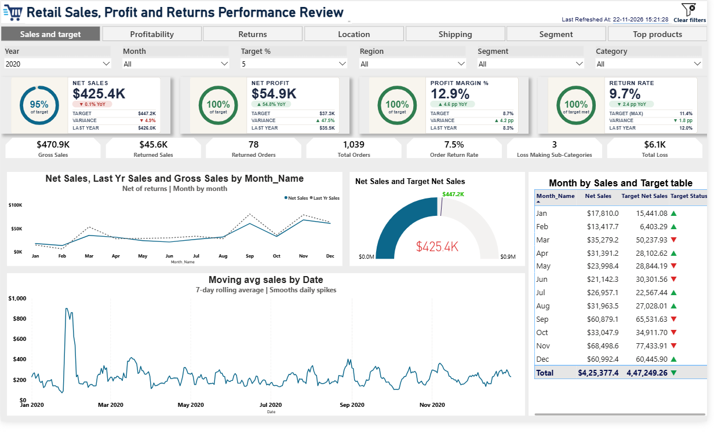
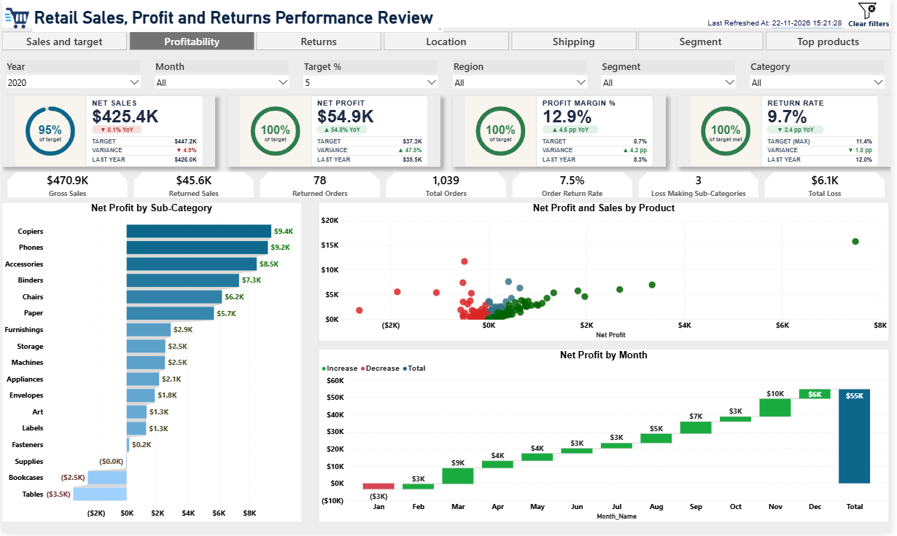
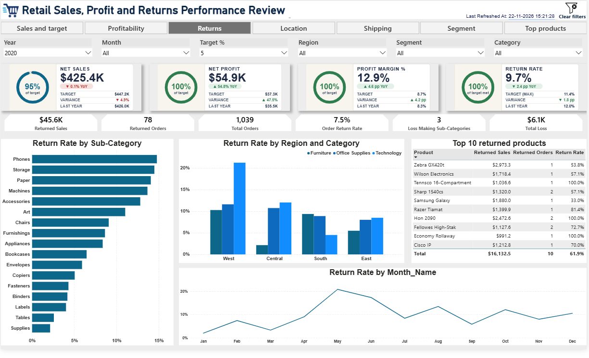
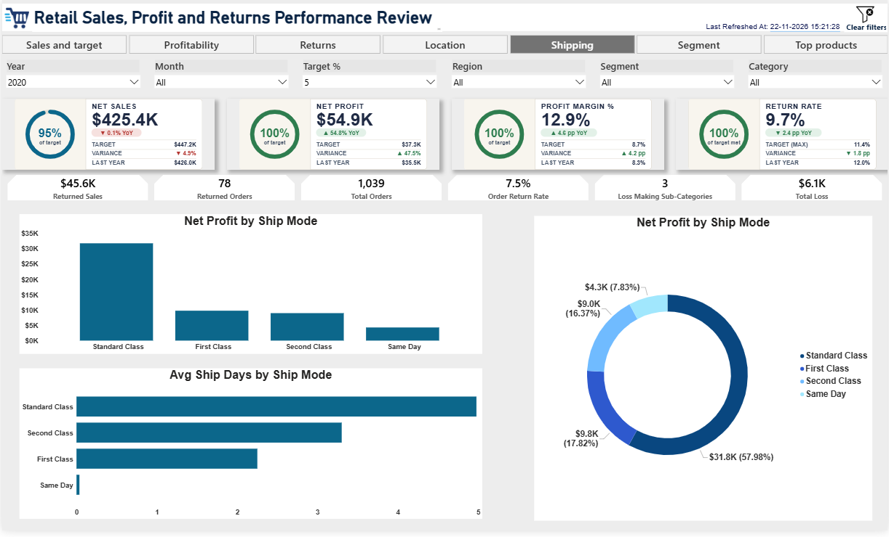
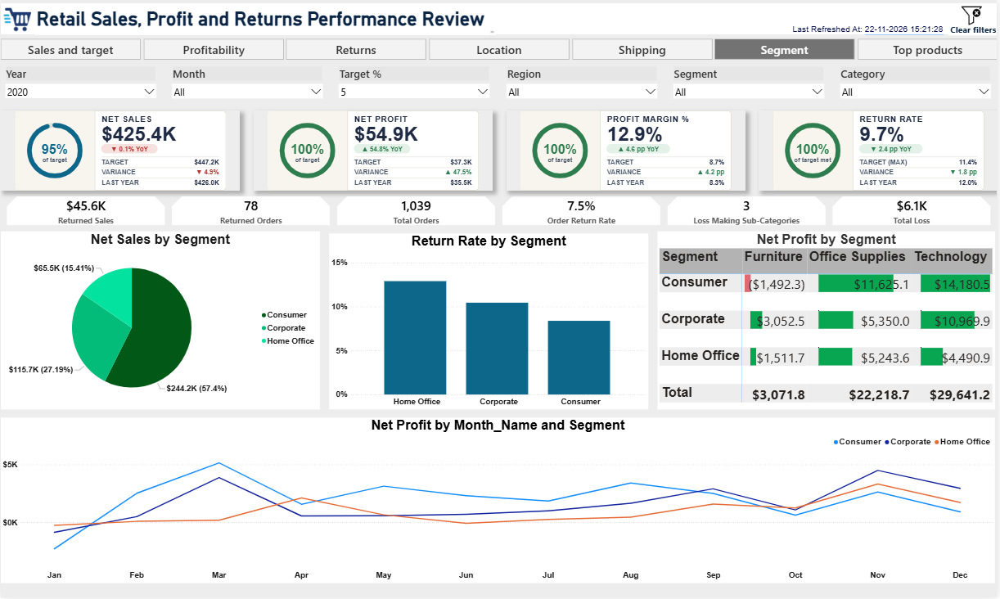
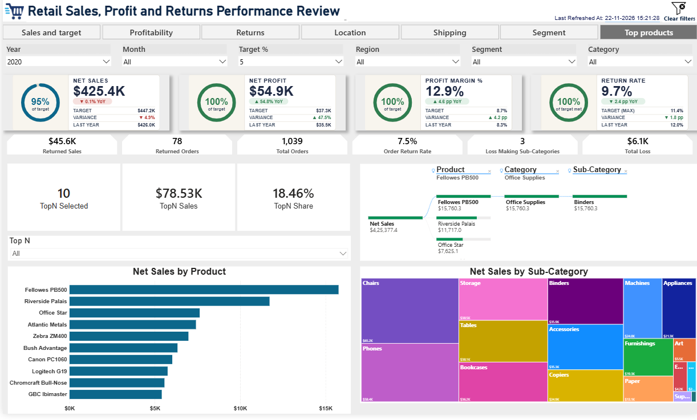

# Retail Sales, Profit and Returns Performance Review

**Sales stayed flat. Profit grew 55%. This Power BI report shows how that became visible.**

> **At a glance:** Power BI case study on a sample retail dataset | Power Query, DAX, What-if parameters | 2020: Net Sales flat, Net Profit +54.8%, margin 8.3% to 12.9% | 7 report pages
>
> Learning project. The numbers are for practice, not real business results.

---

## The story in one minute

Imagine you run a retail business. Every year, sales land in a separate Excel file. Customers send some orders back, but those returns are still counted as sales. Then someone asks a simple question:

**"How much did we actually keep?"**

Nobody can answer it quickly. That is the problem this project solves.

### Chapter 1: The mess

- Sales were split across yearly files, with customers, products, people and regions in four more tables.
- Returned orders were counted as sales, so sales looked better than they really were.
- It was hard to see which products, regions and customer segments made money, and which ones lost it.
- There was no clear goal to compare against.

### Chapter 2: Cleaning it up

- Combined the yearly sales files and the returns file into one clean model with Power Query.
- Marked every returned order, so returns could be taken out of sales.
- Built a star-schema model with a calendar table, so comparisons with last year work correctly.

### Chapter 3: What the data said (2020)

| Question | Answer |
|---|---|
| Did sales grow? | No. Net Sales were **$425.4K**, flat against last year (-0.1%). |
| Did profit grow? | Yes. Net Profit was **$54.9K**, up **54.8%**. |
| Why does that matter? | Profit margin rose from **8.3% to 12.9%** on the same sales. |
| Are returns getting better? | Yes. Return rate fell from **12.0% to 9.7%** (by sales value). By order count, 78 of 1,039 orders (7.5%) came back. |
| Where is money lost? | Tables and Bookcases are about 17% of Net Sales, yet together they lost **$6.0K**. |
| Where is money made? | Copiers, Phones and Accessories earned about **half** of all profit. |
| Which region leads? | East earned the most profit (**$19.1K**). South was lowest on both sales and profit. |
| Did sales meet the goal? | At a 10% growth target, **7 of 12 months** fell short. |

The lesson: sales alone can hide what is really happening. Looking at profit and returns changes the story.

### Chapter 4: What comes next

- A discount and product-mix analysis, to explain why the margin improved.
- A sales forecast.

---

## Take a tour of the report

The report has 7 pages. Every page has the same KPI cards and slicers (Year, Month, Target %, Region, Segment, Category), so the numbers stay consistent.

### 1. Sales and target

### 2. Profitability

### 3. Returns

### 4. Location

### 5. Shipping

### 6. Segment

### 7. Top products

---

## How to read it

- Pick a **Year** and move the **Target %** slicer to test different growth goals.
- Green means good. Return rate is the exception: a higher return rate shows in red, because lower is better.
- On the map, bubble size shows sales and color shows profit, so a big red bubble means high sales with a loss.

---

## Technical details

### Data model

Star schema. `SalesRecords` is the fact table. `Customer Data`, `Product Data`, `Region Data`, `People` and a DAX `Calender` table are the dimensions. All measures sit in a separate `MyMeasures` table.

### Power Query steps

- Removed null rows from Order ID, Customer ID and the People table.
- Fixed the missing headers in the Product table.
- Combined the yearly sales files into one `SalesRecords` table.
- Merged Sales Returns into `SalesRecords` and flagged returned orders (null replaced with FALSE).

### Key measures

| Measure | Idea |
|---|---|
| Gross Sales | All sales, including returned orders |
| Net Sales | Sales excluding returned orders |
| Net Profit | Net Sales minus Net Cost |
| Profit Margin % | Net Profit divided by Net Sales |
| Return Rate | Returned Sales divided by Gross Sales |
| Order Return Rate | Returned Orders divided by Total Orders |
| Last Yr Sales | Same period, one year earlier (`SAMEPERIODLASTYEAR`) |
| Target | Last year's value x (1 + growth %), with growth % from a What-if parameter |
| Moving avg sales | 7-day rolling average, to smooth daily spikes |

Return rate is lower-is-better, so its target is last year's rate reduced by the chosen %, and its colors are reversed.

### Design decisions

- Gross Sales minus Returned Sales equals Net Sales, so the numbers reconcile across pages.
- The same KPI cards and slicers appear on every page, so comparisons stay consistent.
- The page navigation highlights the current page.

---

## Built with

Power BI Desktop, Power Query, DAX, star-schema modelling, What-if parameters.

## Limits to keep in mind

- Sample dataset, so results should not be read as real business performance.
- Returns are flagged by order, so one returned item can mark a whole order as returned.

## About me

I'm **Hemalatha Illa**, an aspiring Data Analyst passionate about transforming raw data into meaningful business insights.

This project helped me practise the complete analytical workflow — data cleaning, data modelling, DAX calculations, interactive dashboard development, and communicating insights through data storytelling.

LinkedIn: [Hemalatha Illa](https://www.linkedin.com/in/hemalatha-illa-254a9b266/)
