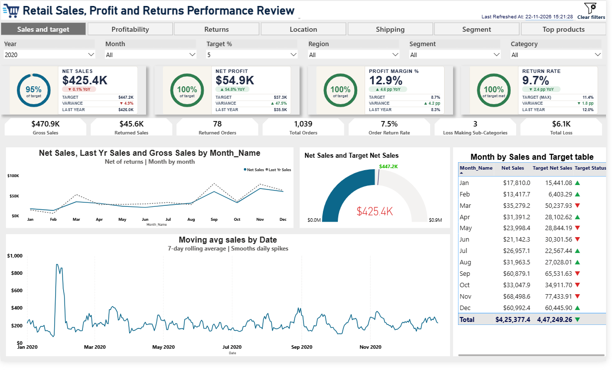
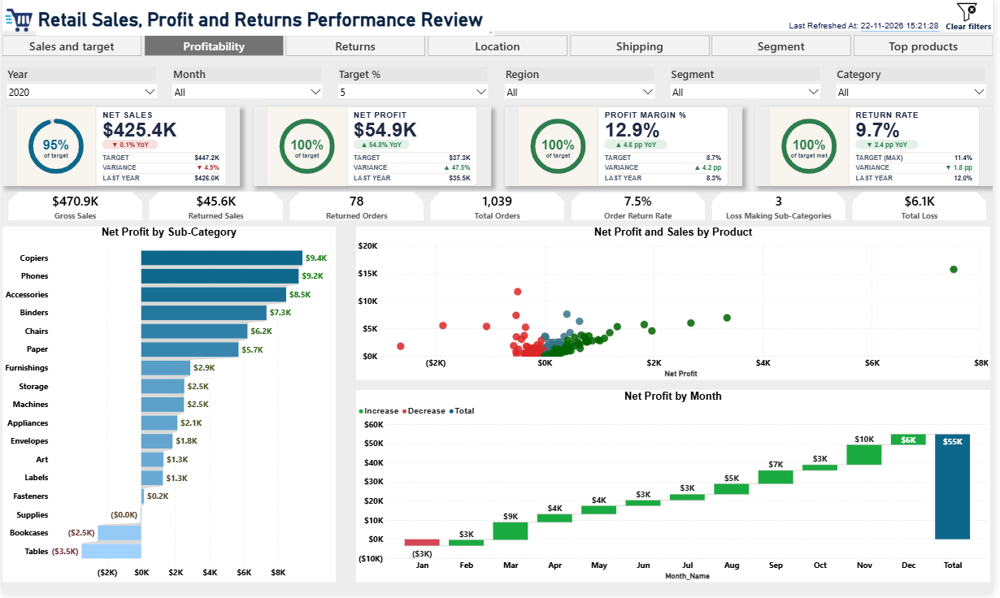
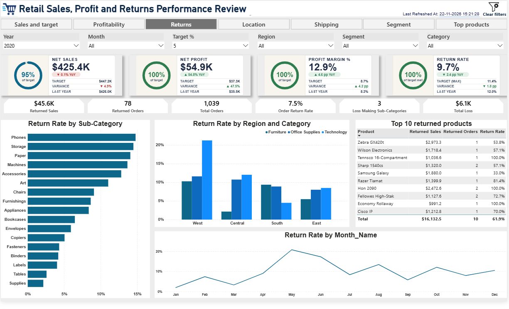
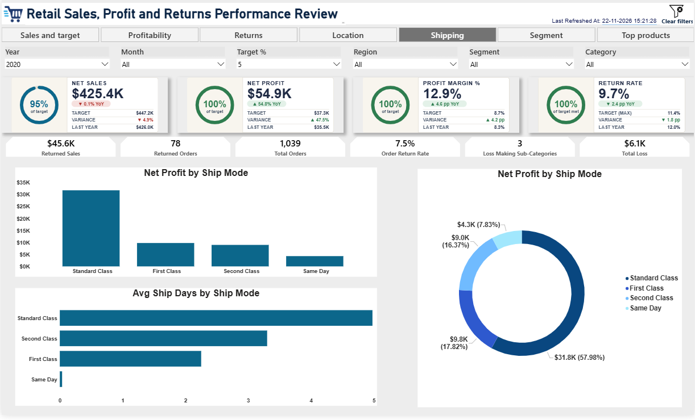
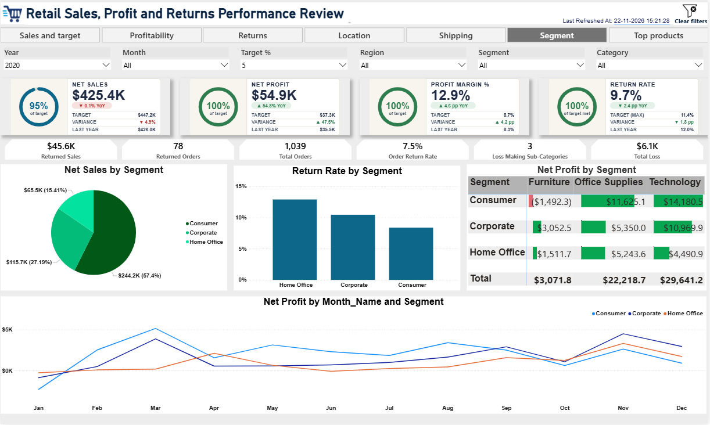

# Retail Sales, Profit and Returns Performance Review

A 7-page Power BI case study on a sample retail dataset. It separates returned orders from sales, so Net Sales and Net Profit show what the business actually keeps.

> Learning project using a sample dataset. The figures are not real business results.

## Report pages

## Business problem

- Sales were spread across separate yearly Excel files.
- Returned orders were counted as sales, which overstated sales performance.
- It was hard to see which products, locations and segments were actually profitable, and whether sales were on track against a goal.

## What the report delivers

- A clean data model that combines yearly sales, returns and 4 dimension tables (Customers, Products, People, Region) using Power Query
- Gross Sales, Net Sales and Net Profit calculated after returns
- KPI cards for sales, profit, margin, return rate and YoY growth, each with a target
- Monthly sales vs target, with a status indicator for every month
- Seven pages: Sales and target, Profitability, Returns, Location, Shipping, Segment, Top products
- Synced slicers (Year, Month, Target %, Region, Segment, Category) and navigation that highlights the current page

## Key findings (2020 view, all other filters on All, Target % = 10)

| Metric | Value |
|---|---|
| Net Sales | $425.4K, flat vs last year (-0.1%) |
| Net Profit | $54.9K, up 54.8% |
| Profit margin (Net Profit / Net Sales) | 12.9%, up from 8.3% |
| Return rate (by sales value) | 9.7%, down from 12.0% |
| Order return rate (by order count) | 7.5% (78 of 1,039 orders) |
| Loss-making sub-categories | 3, with a combined loss of $6.1K |

- Tables and Bookcases are about 17% of Net Sales but together lost $6.0K.
- Copiers, Phones and Accessories generated about half of total profit.
- East earned the most profit ($19.1K). South was lowest on both sales and profit.
- At a 10% growth target, 7 of 12 months fell short.

## Data model

Star schema: `SalesRecords` is the fact table. `Customer Data`, `Product Data`, `Region Data`, `People` and a DAX `Calender` table are the dimensions. Measures sit in a separate `MyMeasures` table.

## Key measures

| Measure | Idea |
|---|---|
| Gross Sales | All sales, including returned orders |
| Net Sales | Sales excluding returned orders |
| Net Profit | Net Sales minus Net Cost |
| Profit Margin % | Net Profit divided by Net Sales |
| Return Rate | Returned Sales divided by Gross Sales |
| Order Return Rate | Returned Orders divided by Total Orders |
| Last Yr Sales | Same period, one year earlier (`SAMEPERIODLASTYEAR`) |
| Target Sales | Last year's value x (1 + growth %), where growth % comes from a What-if parameter |

Return rate is a lower-is-better KPI, so its target is last year's rate reduced by the chosen %, and the colors are reversed.

## Design decisions

- Gross Sales - Returned Sales = Net Sales, so the numbers reconcile across pages.
- The same KPI cards and slicers appear on every page, so comparisons stay consistent.
- Map: bubble size shows sales and color shows profit, which highlights high-sales but low-profit locations.

## Limitations and next steps

- Sample dataset. Results should not be read as real business performance.
- Returns are flagged at order level, so one returned item can mark a whole order as returned.
- Next: a discount and product-mix analysis to explain what drove the margin change, and a sales forecast.

## Files

| Path | Description |
|---|---|
| `Retail_Sales_Profit_Returns_Performance_Review.pbix` | Power BI report |
| `Retail_Sales_Profit_Returns_Performance_Review_2020.pdf` | PDF export of all 7 pages (2020 view) |
| `screenshots/` | One image per page |

## Tools

Power BI Desktop, Power Query, DAX, star-schema modelling, What-if parameters.

## Contact

Hemalatha Illa | https://www.linkedin.com/in/hemalatha-illa-254a9b266/
